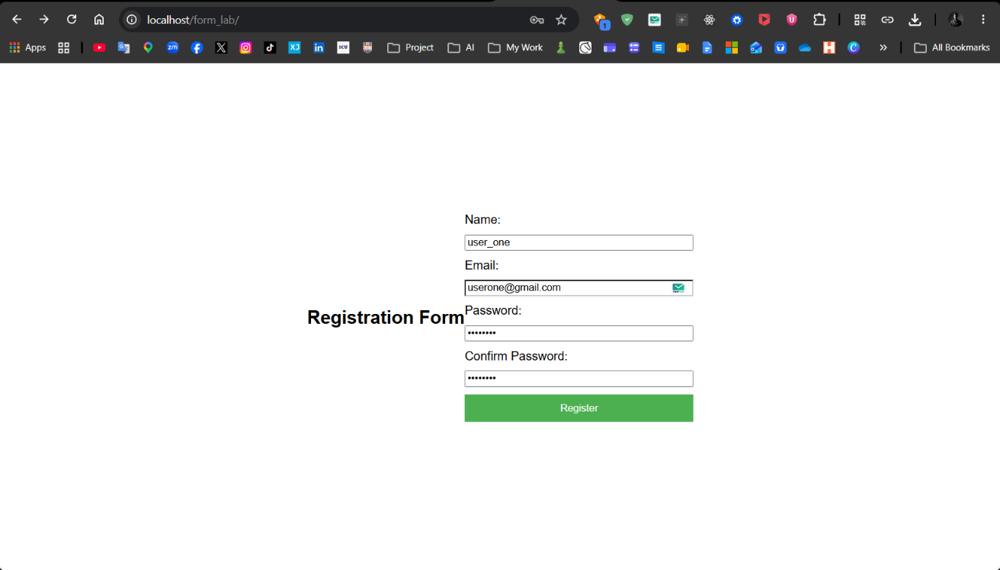
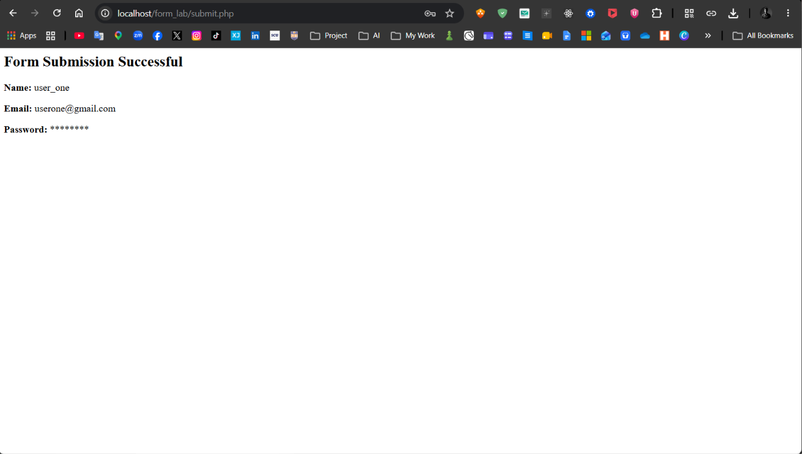

# Form Lab

A simple registration form built with HTML, CSS, JavaScript, and PHP.

## Features

- Registration form with name, email, password, and password confirmation fields.
- Client-side validation for required fields, email format, password length, and matching passwords.
- PHP form processing with escaped output.
- Password displayed as masked characters after submission.

## Project Structure

```text
form_lab/
├── index.html
├── styles.css
├── script.js
├── submit.php
├── README.md
├── doc/
│   └── Practical-Lab6-Task1.pdf
│   └── LAB-6.md
└── evidence/
    ├── registration_form.png
    └── submission_result.png
```

## Running the Project

1. Place the project inside the XAMPP `htdocs` directory.
2. Start Apache from the XAMPP Control Panel.
3. Open [http://localhost/form_lab/](http://localhost/form_lab/) in a browser.
4. Complete and submit the registration form.

## Evidence

### Registration Form



### Successful Submission



